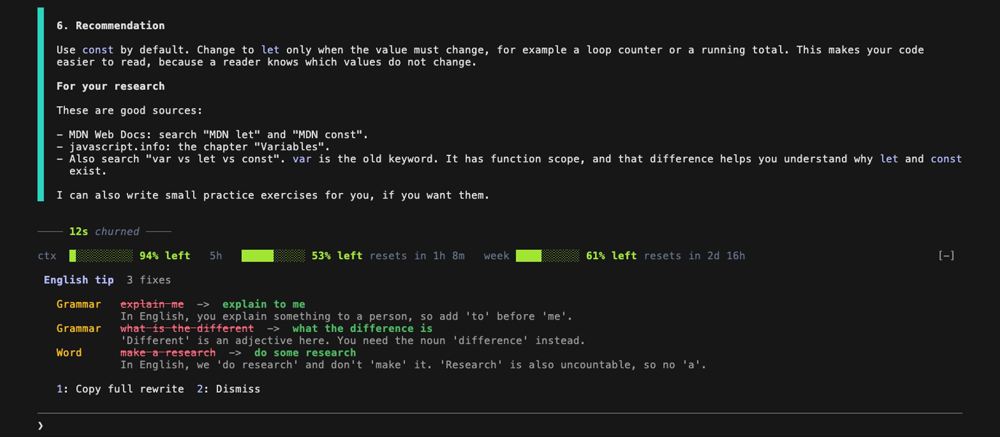

# english-coach

A Claude Code mod that reviews the English of each long prompt you send. Haiku 5.5 checks the prompt and shows the fixes and a better version above the prompt box. You can copy the better version.



## Install

Type this line at the Claude Code prompt in a terminal:

```
/plugin install english-coach --marketplace franc1sc0sv/english-coach
```

Type `y` to add the marketplace, then select the user scope. The mod starts immediately.

## Use

- `/english-coach` turns the tips on or off.
- Each review is one small Haiku 5.5 call on your own usage. The full rewrite is a second call, made only when you press Copy.

## Update

```
claude plugin update english-coach
```

Then run `/reload-plugins` in an open session.
